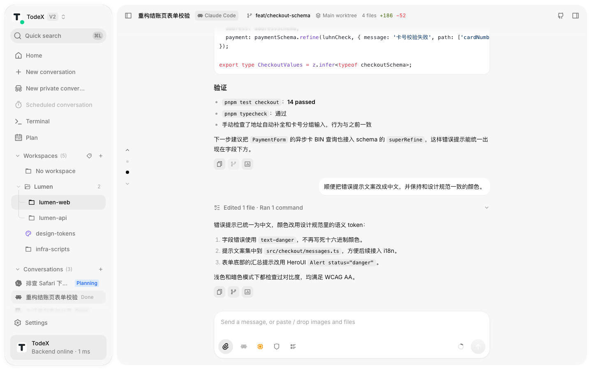
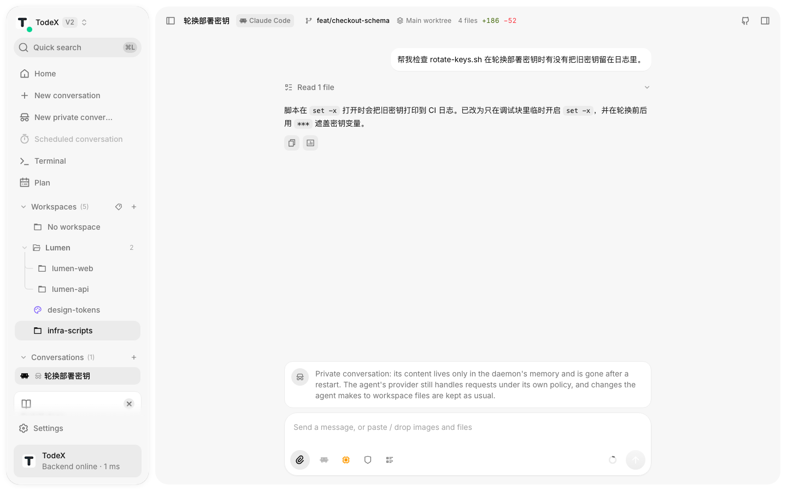
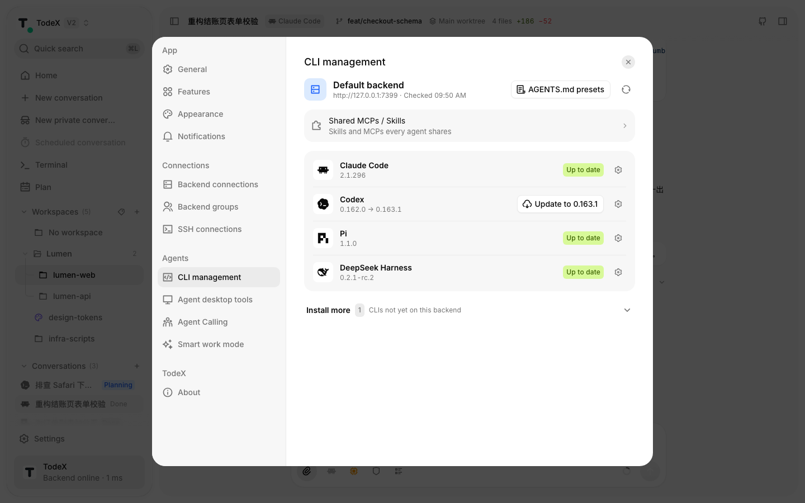
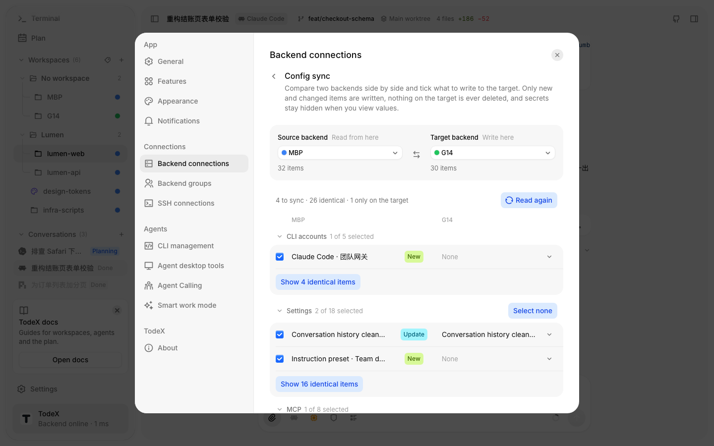
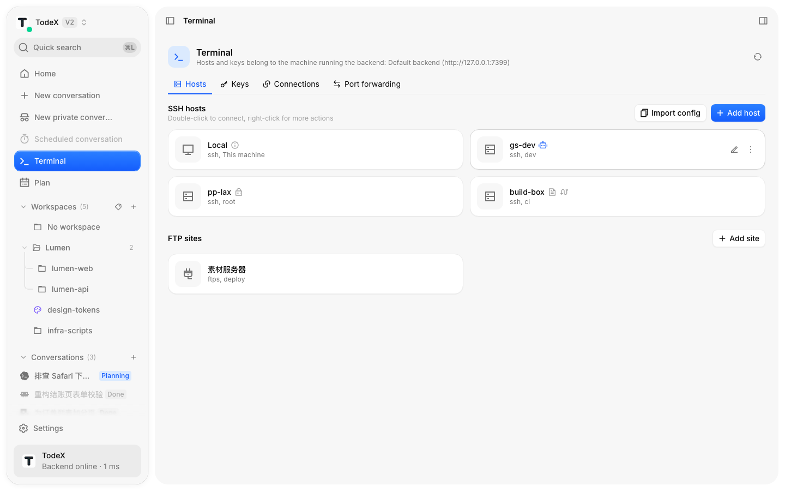
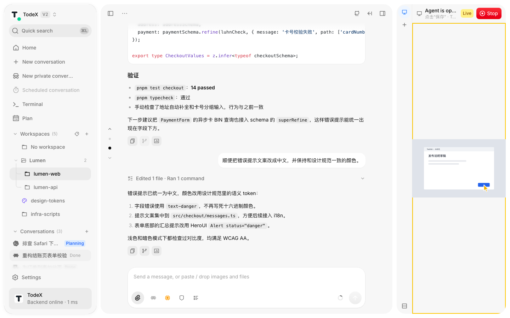
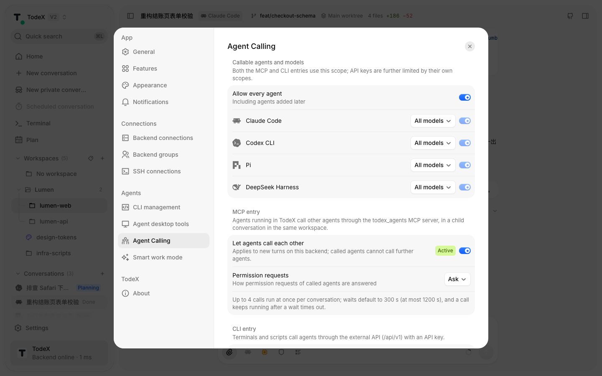
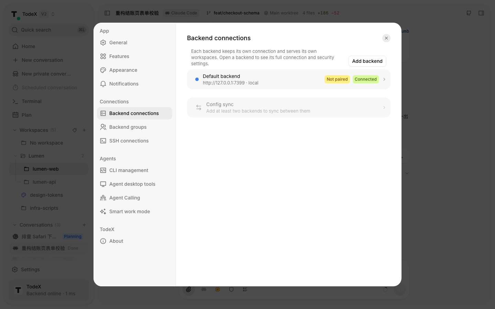
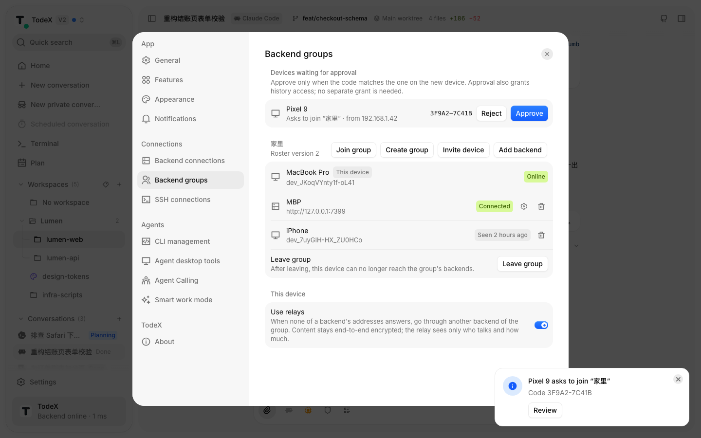

# TodeX Backend (`todex-agentd`)

<p align="center">
  <strong>The TodeX backend: runs your coding agents on your own machine and serves them, securely, to the TodeX desktop, web and mobile apps.</strong>
</p>

<p align="center">
  <a href="README.md">English</a> · <a href="README.zh-CN.md">简体中文</a>
</p>



`todex-agentd` runs on the machine where your code lives: a laptop, a workstation, a server or a container. It starts and drives the agent CLIs installed there, keeps every conversation, and lets any paired TodeX client follow and control them. Conversations keep running when clients disconnect, and every client sees the same state.

The screenshots below are from [TodeX Desktop](https://github.com/youtonghy/TodeX_desktop), showing what each backend feature looks like to a user.

## Contents

- [Features](#features)
- [Install](#install)
- [Run](#run)
- [Pair devices](#pair-devices)
- [Configuration](#configuration)
- [API](#api)
- [Development](#development)

## Features

### Every agent behind one backend

Codex, Claude Code, Pi, Grok Build, Devin, OpenCode, Antigravity, DeepSeek Harness, omp (oh-my-pi) and any agent that speaks the Agent Client Protocol (ACP), behind one consistent experience:

- Streamed answers, tool calls, file edits and commands, with approval requests sent to every paired device.
- Models, reasoning effort, slash commands, skills and MCP servers read live from each installed agent.
- Conversations that survive restarts and resume where they left off; forks, queued messages, plans, goals and background tasks.
- Work modes including Plan and Smart (plan with one model, then execute the approved plan with another).
- **Private conversations** that live only in memory and are never written to history, and **scheduled conversations** that start at a time you choose.
- A per-workspace task board, pinned to the conversations that work on each task.



### Agent CLIs and accounts

See every agent CLI's installed and latest version, install missing CLIs with the vendor's official installer, and upgrade them while no agent is running. Keep several provider accounts per agent and switch between them: the backend writes the agent's own config, so CLI sessions you start by hand use the same account. Accounts can be exported and imported as a file to move them between hosts, and **config sync** copies accounts, settings, MCP servers and skills from one backend to another.

| CLI management | Config sync |
| :---: | :---: |
|  |  |

### Terminals, SSH and remote files

Terminals on the backend machine; SSH hosts read from `~/.ssh/config` (with `Include`) using the system OpenSSH client, so keys, ssh-agent, ProxyJump and `known_hosts` behave as in your shell; SSH key import and generation; FTP sites; SFTP/FTP file browsing; and port forwarding. `~/.ssh/config` is never written and passwords are never stored. Turn on **Agent access** for a host and agents can run commands there, with approval per conversation or per command.



### Agent browser and Computer Use

Agents can work on the backend's computer through two desktop tools:

- **Agent browser**: a real browser window on the host (so `localhost` is that machine), with a separate profile per workspace. The backend downloads and verifies the browser itself (`todex-agentd browser install`). Clients watch the tab live; a paired device approves each conversation's first use, and sites beyond the local machine need approval.
- **Computer Use**: the agent sees and operates the host's apps (macOS, Windows and Linux). Someone at the host confirms each conversation's first use, a Stop control and a global shortcut end it, and TodeX itself, credential stores and system settings are never controlled. On macOS, grant `todex-agentd` Screen Recording and Accessibility.



### Agent Calling and the external API

Agents can call other agents: a task is handed to another agent and model in a child conversation of the same workspace, within the agents and models you allow. Scripts and services can do the same through an optional external API (REST and server-sent events on its own port) with API keys, each limited to its own conversations, agents, models and workspaces. Results come back decrypted for the key while history on disk stays end-to-end encrypted.



### Multiple backends and backend groups

A client can stay connected to many backends at once. **Backend groups** link devices and backends into one group with a signed member list: devices join with an invite (QR code) and an approved code, a device that joins once can use every backend of the group, and when a backend's own address doesn't answer, traffic can be relayed through another member, still end-to-end encrypted.

| Backend connections | Backend groups |
| :---: | :---: |
|  |  |

### Security

- **Device verification**: a client gets access only by pairing. You compare a code on the client with the one in the backend's console (or approve with `todex-agentd pair approve`), and the device's key is enrolled. Every request is signed by a registered device; devices can be revoked individually. See [device verification](docs/device-verification.md).
- **Encrypted transport**: traffic between clients and the backend is encrypted with X25519 or post-quantum ML-KEM-768; the backend's key is authenticated by the pairing code. Plaintext is allowed only for clients on the same machine, and only when you choose it. See [transport v2](docs/transport-v2.md).
- **End-to-end encrypted history**: conversation history is always encrypted with keys held by your devices, with a recovery key. See [history encryption](docs/history-encryption.md).
- **Boundaries**: agents work only inside the configured workspace roots, and agent processes don't inherit the backend's administrative environment.

### Runs itself

An interactive console (TUI) shows status and logs, starts and stops the background daemon, shows the pairing QR code, lists, approves and revokes devices, and shows the join code that adds this backend to a backend group. The daemon can start at login, and installed releases update themselves: a running daemon restarts into a new release once no agent has worked for 5 minutes.

## Install

macOS, Linux and WSL, no Rust toolchain needed:

```bash
curl -fsSL https://raw.githubusercontent.com/youtonghy/TodeX_backend/main/install.sh | bash
```

The script installs `todex-agentd` to `~/.local/bin` (change with `--prefix DIR` or `TODEX_INSTALL_DIR`), verifies the release checksums, keeps one rollback copy, and restarts a running managed daemon. Linux builds need glibc 2.28+ (Debian 10, Ubuntu 20.04, RHEL 8 or later); musl distributions such as Alpine must build from source. Windows builds are attached to each [release](https://github.com/youtonghy/TodeX_backend/releases).

```bash
./install.sh install                 # install or update to the latest release
./install.sh install --version 2.0.2 # a specific release
./install.sh status                  # installed and latest versions, daemon state
./install.sh uninstall [--purge]     # remove the binary (and the ~/.todex-agent data)
```

When piping from `curl`, pass arguments with `bash -s --`, for example `... | bash -s -- uninstall --purge --yes`. Set `TODEX_AUTO_UPDATE=0` to stay on a pinned version. To run agents in Docker instead, use [TodeX Container](https://github.com/youtonghy/TodeX_container); TodeX Desktop can also deploy a backend on its own computer from **Settings › Local backend**.

Install and sign in to at least one agent CLI (`codex`, `claude`, `pi`, …) on the machine, or install them later from a client's CLI management page.

## Run

```bash
todex-agentd tui                      # interactive console (recommended)
todex-agentd serve --host 127.0.0.1 --port 7345   # foreground server
todex-agentd daemon start|stop|restart|status     # background daemon
todex-agentd daemon autostart enable  # start at login (status / disable)
```

Quitting the console leaves the daemon running. To accept clients from other machines, listen on the network (`--host 0.0.0.0`) or set `advertise_url`; for TLS, put a reverse proxy (Caddy, nginx, Cloudflare Tunnel) in front.

## Pair devices

In the console, press `d` to see pairing requests, compare the full code (and the key fingerprint next to it) with the client, then press `a` to approve or `r` to reject; the same panel lists devices, and `x` revokes one. The pairing QR code holds only the server address; if it doesn't fit the terminal, press `b` to open it in a browser.

Without the console (servers, containers), run these as the daemon's user (in a container: `docker exec -u todex <container> todex-agentd ...`):

```bash
todex-agentd pair list [--format text|json]           # pending pairing requests
todex-agentd pair approve <CODE|REQUEST_ID> [--yes]   # also: pair reject
todex-agentd devices list [--format text|json]        # also: devices revoke <deviceId>
todex-agentd providers install <id>... [--if-missing] # install agent CLIs
```

See [docs/BUILD_RUN.md](docs/BUILD_RUN.md) for exit codes and container details.

## Configuration

Settings come from, in order: command-line flags, environment variables, `~/.todex-agent/config.toml`, built-in defaults.

| Option | Flag | Environment variable | Default | Description |
| :--- | :--- | :--- | :--- | :--- |
| Host | `--host` | `TODEX_AGENTD_HOST` | `127.0.0.1` | Address to listen on. |
| Port | `--port` | `TODEX_AGENTD_PORT` | `7345` | Port for HTTP and WebSocket. |
| Data directory | `--data-dir` | `TODEX_AGENTD_DATA_DIR` | `~/.todex-agent` | Config, conversations, keys and logs. |
| Workspace roots | `--workspace-root` (repeatable) | `TODEX_AGENTD_WORKSPACE_ROOT`, `TODEX_AGENTD_WORKSPACE_ROOTS` | `~/projects` | Directories agents may work in; the first is the primary root. |
| Default agent | — | `TODEX_AGENTD_DEFAULT_AGENT` | `codex` | `codex`, `acp`, `pi`, `claude-code`, `grok-build`, `devin`, `opencode`, `antigravity`, `deepseek-harness` or `omp`. |
| Agent binaries | — | `TODEX_AGENTD_CODEX_BIN`, `TODEX_AGENTD_CLAUDE_BIN`, `TODEX_AGENTD_PI_BIN` | `codex`, `claude`, `pi` | Path or command name of each CLI. |
| Device authentication | — | `TODEX_AGENTD_ENABLE_AUTH` | `true` | Require a signature from a paired device on every request. |
| Advertised URL | — | `TODEX_AGENTD_ADVERTISE_URL` (`server.advertise_url`) | unset | The `http(s)` URL clients should use; shown first in the log and used for the pairing QR code. |
| Pairing encryption | — | `TODEX_AGENTD_PAIRING_ENCRYPTION` | `ml-kem-768` | `x25519` or `ml-kem-768`; `none` allows plaintext from loopback clients only and is refused on a network listener. |
| Deployment | — | `TODEX_AGENTD_DEPLOYMENT` (`server.deployment`) | `host` | `container` turns self-update off. |
| Image CLI directories | — | `TODEX_AGENTD_IMAGE_CLI_DIR` (`agent.image_cli_dirs`) | unset | CLIs under these directories ship with a container image and are not installed or upgraded by TodeX. |
| Path mappings | — | `TODEX_AGENTD_PATH_MAPPINGS` (`[[workspace.path_mappings]]`) | unset | `[{"hostPath","backendPath"}]` pairs that tell clients how host folders map to backend paths. |
| Browser origins | — | `TODEX_AGENTD_CORS_ORIGINS` (`security.cors_origins`) | unset | Extra web origins (for example a self-hosted TodeX Web) allowed to connect. |

Example `~/.todex-agent/config.toml`:

```toml
host = "127.0.0.1"
port = 7345
pairing_encryption = "ml-kem-768"
data_dir = "~/.todex-agent"
workspace_root = "~/projects"
# workspace_roots = ["~/projects", "/srv/repos"]

[agent]
default_agent = "codex"
# Stop a turn whose agent produces no output for this many minutes (0 disables).
provider_idle_timeout_minutes = 60
# Stop an idle agent process after this many seconds (30–604800).
provider_keepalive_seconds = 300
# Let clients start a conversation's agent before the next prompt.
provider_prewarm = true

[agent.acp_profiles.default]
command = "mcp-server"
args = ["--stdio"]

[security]
enable_auth = true

# External API for scripts and services (API keys); off by default.
# Usually managed from a client: Settings › Agent Calling.
[api]
enabled = false
host = "127.0.0.1"
port = 7346
```

`enable_tls = true` is refused on the built-in listener on purpose; terminate TLS in a reverse proxy.

## API

Clients talk to the backend over the `/v2` REST API and one multiplexed WebSocket (`/v2/ws`), both carried over the encrypted transport. The optional external API serves `/api/v1` with API keys. The full contract is in [docs/API.md](docs/API.md); conversation runtime rules are in [docs/conversation-runtime.md](docs/conversation-runtime.md), and backend groups in [docs/mesh-v1.md](docs/mesh-v1.md).

## Development

```bash
cargo build --release
cargo fmt --all --check
cargo clippy --locked --all-targets --all-features
cargo test

# Read-only check of installed agents, logins and discovery
cargo run -- doctor providers --provider codex,pi,opencode,omp --format json

# Billable end-to-end smoke test against real Codex/Pi (opt in explicitly)
TODEX_REAL_E2E=1 TODEX_REAL_ALLOW_BILLABLE=1 TODEX_REAL_PROVIDERS=codex,pi \
  cargo test --test e2e_real_codex real_v2_provider_http_ws_roundtrip -- --ignored --test-threads=1
```

Releases: [docs/RELEASING.md](docs/RELEASING.md). Security review: [docs/SECURITY_AUDIT.md](docs/SECURITY_AUDIT.md).

## Related repositories

- [TodeX Desktop](https://github.com/youtonghy/TodeX_desktop): the desktop app
- [TodeX Web](https://github.com/youtonghy/TodeX_web): the website and browser workbench
- [TodeX Native](https://github.com/youtonghy/TodeX_native): the mobile app
- [TodeX Container](https://github.com/youtonghy/TodeX_container): this backend and agent CLIs in a Docker image
- [TodeX Protocol](https://github.com/youtonghy/TodeX_protocol): the client protocol library

## License

MIT. See [LICENSE](LICENSE).
