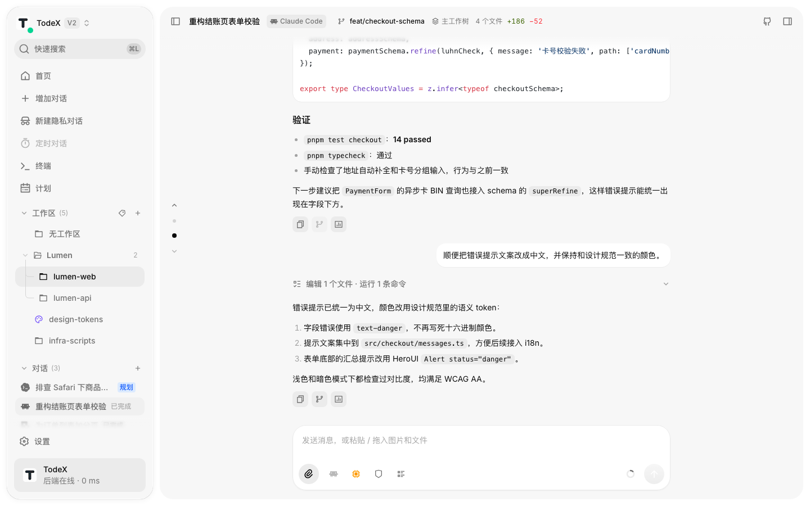
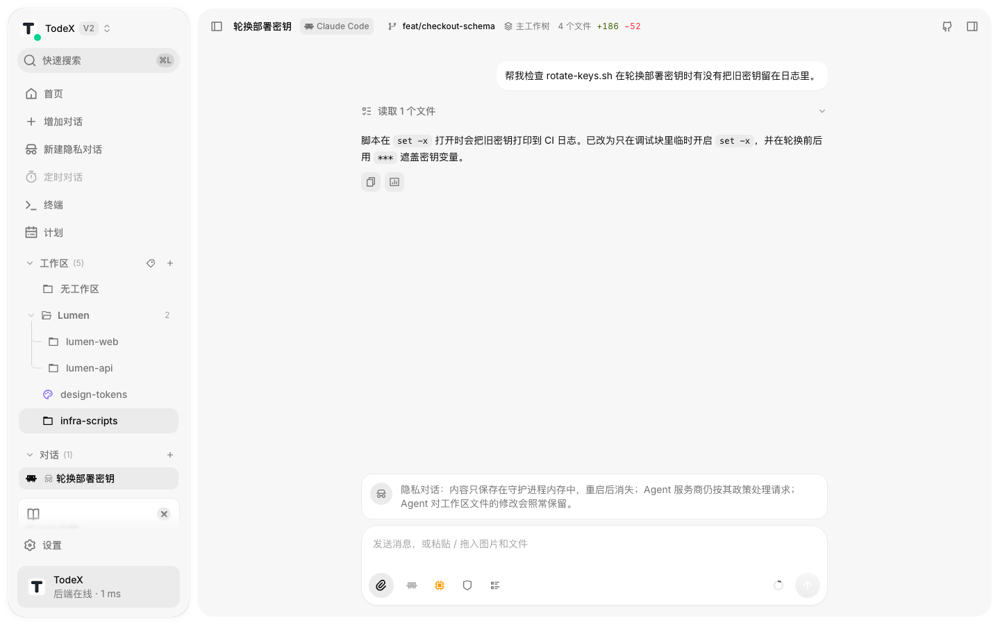
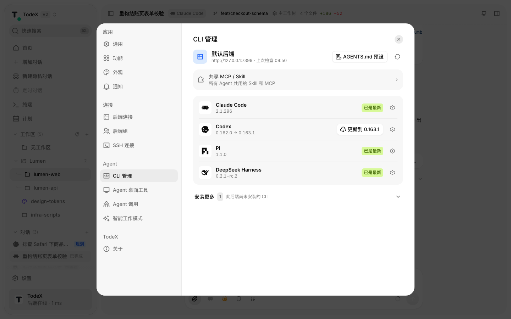
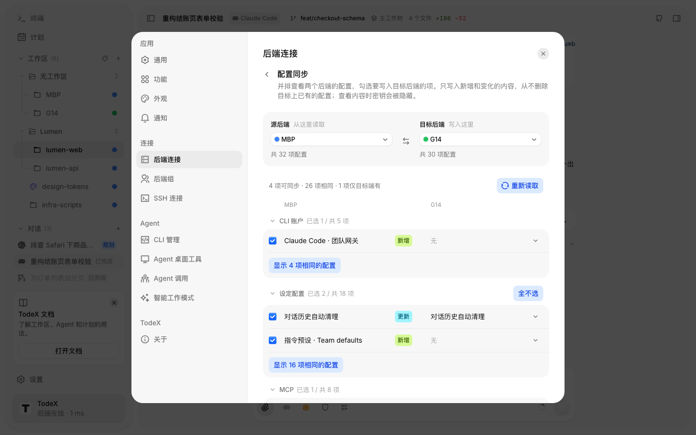
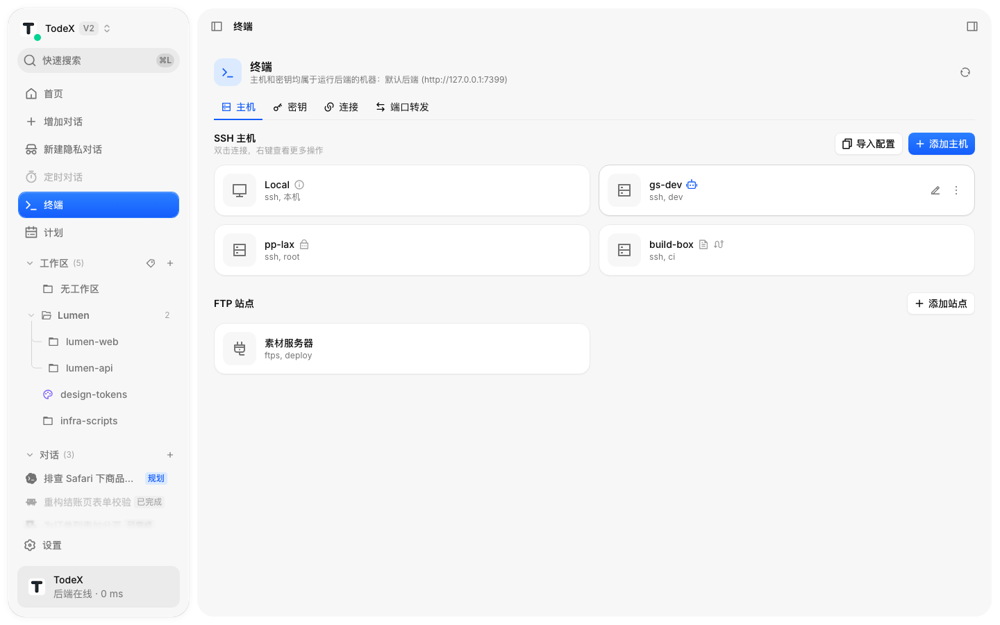
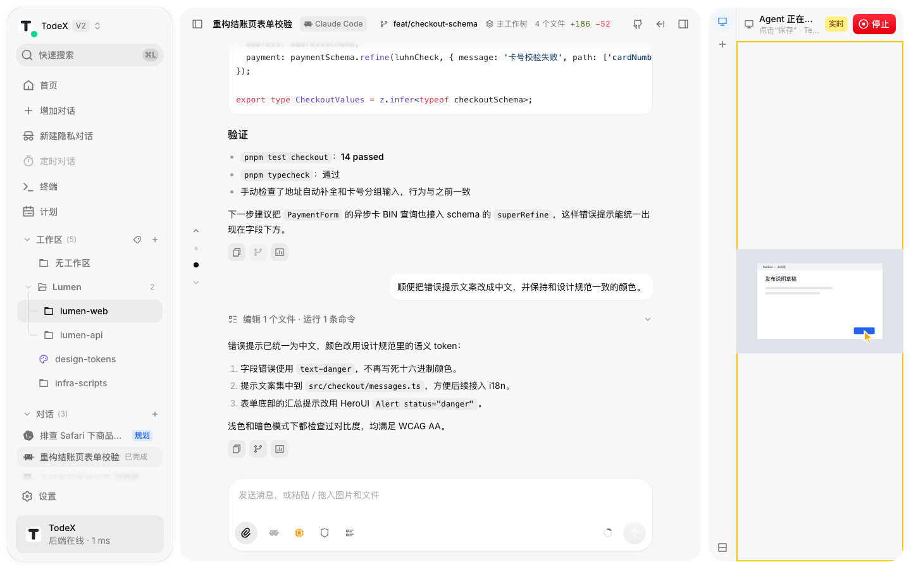
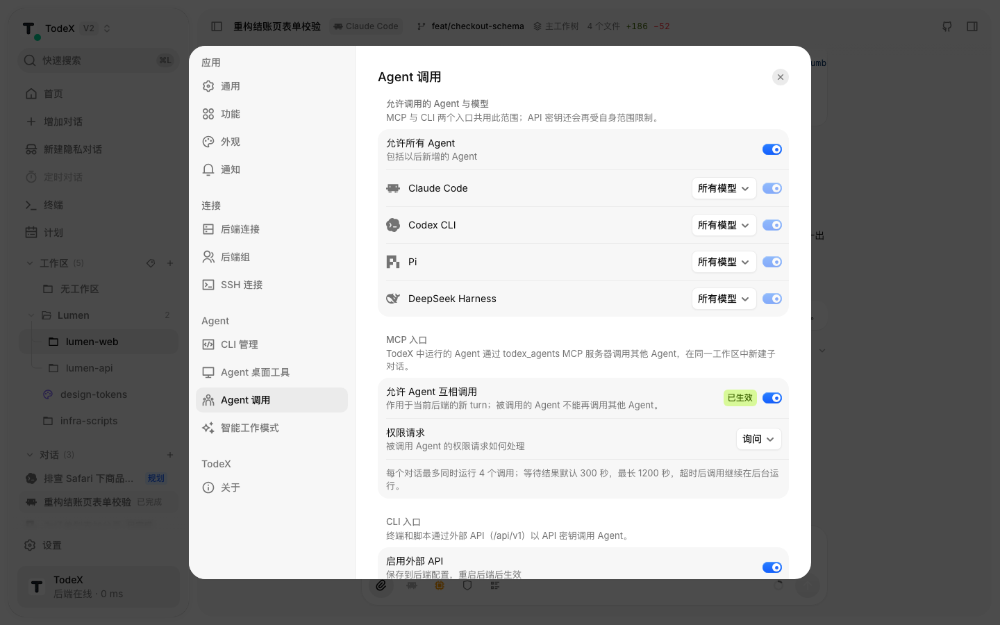
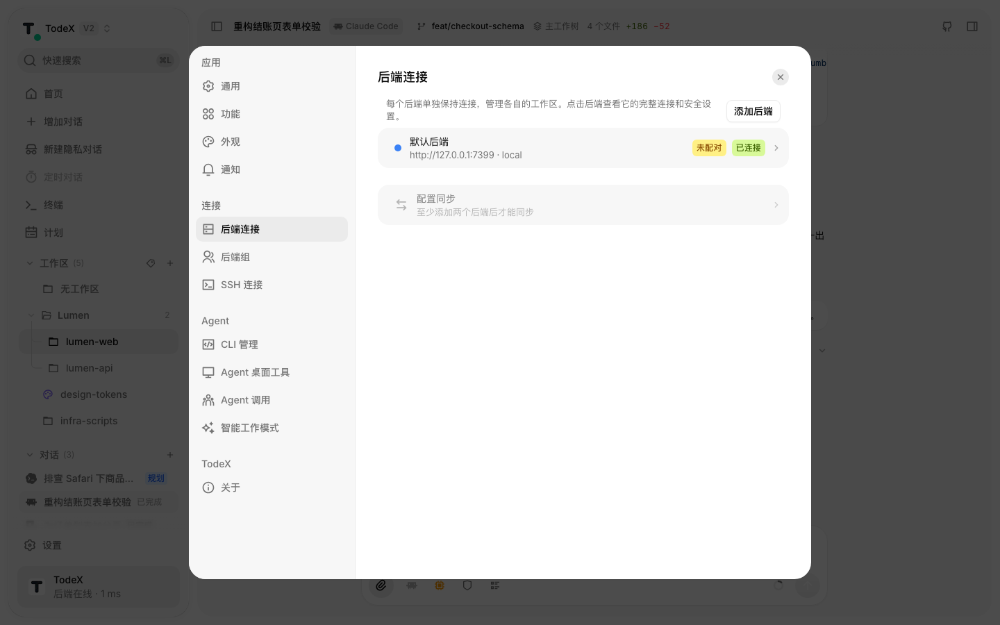
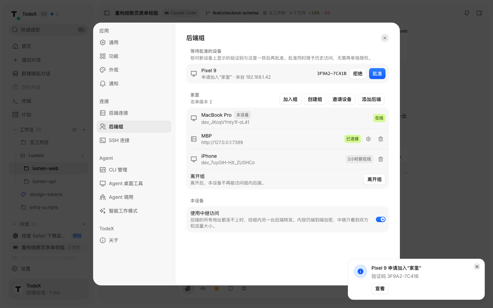

# TodeX 后端（`todex-agentd`）

<p align="center">
  <strong>TodeX 后端：在你自己的机器上运行编程 Agent，并安全地提供给 TodeX 桌面端、Web 端和移动端使用。</strong>
</p>

<p align="center">
  <a href="README.md">English</a> · <a href="README.zh-CN.md">简体中文</a>
</p>



`todex-agentd` 运行在代码所在的机器上：笔记本、工作站、服务器或容器都可以。它启动并驱动这台机器上安装的 Agent CLI，保存所有对话，并让任何已配对的 TodeX 客户端跟进和控制它们。客户端断开后对话照常运行，所有客户端看到的状态一致。

下面的截图来自 [TodeX 桌面端](https://github.com/youtonghy/TodeX_desktop)，展示了各项后端功能在用户眼中的样子。

## 目录

- [功能](#功能)
- [安装](#安装)
- [运行](#运行)
- [配对设备](#配对设备)
- [配置](#配置)
- [API](#api)
- [开发](#开发)

## 功能

### 一个后端，接入所有 Agent

Codex、Claude Code、Pi、Grok Build、Devin、OpenCode、Antigravity、DeepSeek Harness、omp（oh-my-pi），以及任何支持 Agent Client Protocol（ACP）的 Agent，统一的使用体验：

- 流式回答、工具调用、文件修改和命令执行，授权请求会发送到所有已配对设备。
- 模型、思考强度、斜杠命令、Skill 和 MCP 服务器，实时从已安装的 Agent 读取。
- 对话在重启后依然保留，并从中断处继续；支持分叉、消息排队、计划、目标和后台任务。
- 多种工作模式，包括计划模式和智能模式（先用一个模型规划，批准后由另一个模型执行）。
- **隐私对话** 只存在内存中，从不写入历史；**定时对话** 在你选定的时间启动。
- 按工作区划分的任务看板，任务可固定到处理它的对话上。



### Agent CLI 与账号

查看每个 Agent CLI 的已装版本和最新版本，用厂商官方安装脚本安装缺少的 CLI，并在没有 Agent 运行时升级。每个 Agent 可保存多个服务商账号并随时切换：后端会改写 Agent 自己的配置，所以你手动启动的 CLI 会话也使用同一个账号。账号可以导出、导入为文件，在主机之间迁移；**配置同步** 可以把账号、设置、MCP 服务器和 Skill 从一个后端复制到另一个后端。

| CLI 管理 | 配置同步 |
| :---: | :---: |
|  |  |

### 终端、SSH 与远程文件

后端机器上的终端；从 `~/.ssh/config`（含 `Include`）读取 SSH 主机，并使用系统自带的 OpenSSH 客户端，因此密钥、ssh-agent、ProxyJump 和 `known_hosts` 的行为与你的 shell 一致；SSH 密钥的导入与生成；FTP 站点；SFTP/FTP 文件浏览；端口转发。后端从不改写 `~/.ssh/config`，也从不保存密码。为主机打开 **Agent 访问** 后，Agent 就能在上面执行命令，可按对话或逐条命令审批。



### Agent 浏览器与 Computer Use

Agent 可以通过两种桌面工具在后端所在的电脑上工作：

- **Agent 浏览器**：主机上一个真实的浏览器窗口（所以 `localhost` 就是那台机器），每个工作区有独立的配置。浏览器由后端自行下载并校验（`todex-agentd browser install`）。客户端可以实时观看；每个对话首次使用时需要已配对设备批准，访问本机以外的站点也需要批准。
- **Computer Use**：Agent 查看并操作主机上的应用（macOS、Windows、Linux）。每个对话首次使用都需要主机前的人确认，可以用停止按钮或全局快捷键结束；TodeX 本身、凭据存储和系统设置永远不会被控制。macOS 上需要为 `todex-agentd` 授予“屏幕录制”和“辅助功能”权限。



### Agent 调用与外部 API

Agent 可以调用其他 Agent：任务会在同一工作区的子对话中交给另一个 Agent 和模型完成，范围限定在你允许的 Agent 和模型内。脚本和服务也可以通过可选的外部 API（独立端口上的 REST 与 SSE）用 API Key 做同样的事，每个 Key 只能访问自己的对话以及限定的 Agent、模型和工作区。结果以解密后的形式返回给该 Key，而磁盘上的历史依然端到端加密。



### 多后端与后端组

一个客户端可以同时连接多个后端。**后端组** 用签名的成员名单把设备和后端连成一组：设备通过邀请（二维码）和核对验证码加入，加入一次即可使用组内所有后端；某个后端自己的地址连不上时，流量可以经组内其他成员中转，依然端到端加密。

| 后端连接 | 后端组 |
| :---: | :---: |
|  |  |

### 安全

- **设备验证**：客户端只能通过配对获得访问权限。把客户端上的验证码与后端控制台中的核对一致后批准（或用 `todex-agentd pair approve`），该设备的密钥即被登记。每个请求都必须由已登记设备签名，设备可以单独撤销。详见 [设备验证](docs/device-verification.md)。
- **传输加密**：客户端与后端之间的通信使用 X25519 或抗量子的 ML-KEM-768 加密，后端密钥由配对验证码认证。只有同一台机器上的客户端、且在你明确选择时，才允许明文。详见 [transport v2](docs/transport-v2.md)。
- **端到端加密的历史记录**：对话历史始终由你的设备持有的密钥加密，并支持恢复密钥。详见 [历史加密](docs/history-encryption.md)。
- **边界**：Agent 只能在配置的工作区根目录内工作，Agent 进程不会继承后端的管理类环境变量。

### 省心运行

交互式控制台（TUI）可以查看状态和日志、启停后台守护进程、显示配对二维码，并列出、批准和撤销设备。守护进程可以随登录启动，已安装的发行版会自动更新：没有 Agent 工作满 5 分钟后，运行中的守护进程会重启到新版本。

## 安装

macOS、Linux 和 WSL，无需 Rust 工具链：

```bash
curl -fsSL https://raw.githubusercontent.com/youtonghy/TodeX_backend/main/install.sh | bash
```

脚本把 `todex-agentd` 安装到 `~/.local/bin`（可用 `--prefix DIR` 或 `TODEX_INSTALL_DIR` 修改），校验发行版的校验和，保留一份回滚副本，并重启正在运行的托管守护进程。Linux 版本需要 glibc 2.28+（Debian 10、Ubuntu 20.04、RHEL 8 或更新）；Alpine 等 musl 发行版需要从源码构建。Windows 版本附在每个 [发行版](https://github.com/youtonghy/TodeX_backend/releases) 中。

```bash
./install.sh install                 # 安装或更新到最新版本
./install.sh install --version 2.0.2 # 安装指定版本
./install.sh status                  # 已装与最新版本、守护进程状态
./install.sh uninstall [--purge]     # 删除程序（以及 ~/.todex-agent 数据）
```

通过 `curl` 管道执行时，用 `bash -s --` 传参，例如 `... | bash -s -- uninstall --purge --yes`。设置 `TODEX_AUTO_UPDATE=0` 可停留在指定版本。想在 Docker 中运行 Agent，请使用 [TodeX Container](https://github.com/youtonghy/TodeX_container)；TodeX 桌面端也可以在 **设置 › 本机后端** 中直接在本机部署后端。

请在机器上安装并登录至少一个 Agent CLI（`codex`、`claude`、`pi` 等），也可以稍后在客户端的 CLI 管理页面安装。

## 运行

```bash
todex-agentd tui                      # 交互式控制台（推荐）
todex-agentd serve --host 127.0.0.1 --port 7345   # 前台运行
todex-agentd daemon start|stop|restart|status     # 后台守护进程
todex-agentd daemon autostart enable  # 登录时启动（status / disable）
```

退出控制台后守护进程继续运行。要接受其他机器的客户端，请监听网络（`--host 0.0.0.0`）或设置 `advertise_url`；需要 TLS 时，请在前面放一个反向代理（Caddy、nginx、Cloudflare Tunnel）。

## 配对设备

在控制台中按 `d` 查看配对请求，与客户端核对完整验证码（以及旁边的密钥指纹），按 `a` 批准或 `r` 拒绝；同一面板列出已登记设备，按 `x` 撤销。配对二维码只包含服务器地址；终端放不下时按 `b` 在浏览器中打开。

没有控制台时（服务器、容器），以守护进程的用户身份执行（容器中：`docker exec -u todex <container> todex-agentd ...`）：

```bash
todex-agentd pair list [--format text|json]           # 待处理的配对请求
todex-agentd pair approve <CODE|REQUEST_ID> [--yes]   # 另有 pair reject
todex-agentd devices list [--format text|json]        # 另有 devices revoke <deviceId>
todex-agentd providers install <id>... [--if-missing] # 安装 Agent CLI
```

退出码和容器相关细节见 [docs/BUILD_RUN.md](docs/BUILD_RUN.md)。

## 配置

配置的优先级依次为：命令行参数、环境变量、`~/.todex-agent/config.toml`、内置默认值。

| 配置项 | 命令行参数 | 环境变量 | 默认值 | 说明 |
| :--- | :--- | :--- | :--- | :--- |
| 监听主机 | `--host` | `TODEX_AGENTD_HOST` | `127.0.0.1` | 监听地址。 |
| 端口 | `--port` | `TODEX_AGENTD_PORT` | `7345` | HTTP 与 WebSocket 端口。 |
| 数据目录 | `--data-dir` | `TODEX_AGENTD_DATA_DIR` | `~/.todex-agent` | 配置、对话、密钥和日志。 |
| 工作区根目录 | `--workspace-root`（可重复） | `TODEX_AGENTD_WORKSPACE_ROOT`、`TODEX_AGENTD_WORKSPACE_ROOTS` | `~/projects` | Agent 可以工作的目录；第一个为主根目录。 |
| 默认 Agent | — | `TODEX_AGENTD_DEFAULT_AGENT` | `codex` | `codex`、`acp`、`pi`、`claude-code`、`grok-build`、`devin`、`opencode`、`antigravity`、`deepseek-harness` 或 `omp`。 |
| Agent 可执行文件 | — | `TODEX_AGENTD_CODEX_BIN`、`TODEX_AGENTD_CLAUDE_BIN`、`TODEX_AGENTD_PI_BIN` | `codex`、`claude`、`pi` | 各 CLI 的路径或命令名。 |
| 设备认证 | — | `TODEX_AGENTD_ENABLE_AUTH` | `true` | 要求每个请求都带有已配对设备的签名。 |
| 公布地址 | — | `TODEX_AGENTD_ADVERTISE_URL`（`server.advertise_url`） | 不设置 | 客户端应使用的 `http(s)` 地址；会最先打印在日志中，并用于配对二维码。 |
| 配对加密 | — | `TODEX_AGENTD_PAIRING_ENCRYPTION` | `ml-kem-768` | `x25519` 或 `ml-kem-768`；`none` 仅允许本机客户端明文连接，在网络监听上会被拒绝。 |
| 部署类型 | — | `TODEX_AGENTD_DEPLOYMENT`（`server.deployment`） | `host` | 设为 `container` 时关闭自动更新。 |
| 镜像 CLI 目录 | — | `TODEX_AGENTD_IMAGE_CLI_DIR`（`agent.image_cli_dirs`） | 不设置 | 位于这些目录下的 CLI 随容器镜像提供，TodeX 不负责安装或升级。 |
| 路径映射 | — | `TODEX_AGENTD_PATH_MAPPINGS`（`[[workspace.path_mappings]]`） | 不设置 | `[{"hostPath","backendPath"}]`，告诉客户端宿主机文件夹与后端路径的对应关系。 |
| 浏览器来源 | — | `TODEX_AGENTD_CORS_ORIGINS`（`security.cors_origins`） | 不设置 | 额外允许连接的网页来源（例如自行部署的 TodeX Web）。 |

`~/.todex-agent/config.toml` 示例：

```toml
host = "127.0.0.1"
port = 7345
pairing_encryption = "ml-kem-768"
data_dir = "~/.todex-agent"
workspace_root = "~/projects"
# workspace_roots = ["~/projects", "/srv/repos"]

[agent]
default_agent = "codex"
# Agent 连续无输出超过该分钟数时停止当前轮次（0 表示关闭）
provider_idle_timeout_minutes = 60
# 空闲的 Agent 进程在该秒数后停止（30–604800）
provider_keepalive_seconds = 300
# 允许客户端在下一条提示词前预先启动对话的 Agent
provider_prewarm = true

[agent.acp_profiles.default]
command = "mcp-server"
args = ["--stdio"]

[security]
enable_auth = true

# 供脚本和服务使用的外部 API（API Key），默认关闭。
# 通常在客户端的 设置 › Agent 调用 中管理。
[api]
enabled = false
host = "127.0.0.1"
port = 7346
```

内置监听器有意拒绝 `enable_tls = true`；请在反向代理上终止 TLS。

## API

客户端通过 `/v2` REST API 和一个多路复用的 WebSocket（`/v2/ws`）与后端通信，两者都走加密传输。可选的外部 API 在 `/api/v1` 上以 API Key 认证。完整接口见 [docs/API.md](docs/API.md)，对话运行规则见 [docs/conversation-runtime.md](docs/conversation-runtime.md)，后端组见 [docs/mesh-v1.md](docs/mesh-v1.md)。

## 开发

```bash
cargo build --release
cargo fmt --all --check
cargo clippy --locked --all-targets --all-features
cargo test

# 只读检查已安装的 Agent、登录状态与能力发现
cargo run -- doctor providers --provider codex,pi,opencode,omp --format json

# 针对真实 Codex/Pi 的计费端到端冒烟测试（需显式开启）
TODEX_REAL_E2E=1 TODEX_REAL_ALLOW_BILLABLE=1 TODEX_REAL_PROVIDERS=codex,pi \
  cargo test --test e2e_real_codex real_v2_provider_http_ws_roundtrip -- --ignored --test-threads=1
```

发布流程见 [docs/RELEASING.md](docs/RELEASING.md)，安全审计见 [docs/SECURITY_AUDIT.md](docs/SECURITY_AUDIT.md)。

## 相关仓库

- [TodeX Desktop](https://github.com/youtonghy/TodeX_desktop)：桌面端应用
- [TodeX Web](https://github.com/youtonghy/TodeX_web)：官网与浏览器版工作台
- [TodeX Native](https://github.com/youtonghy/TodeX_native)：移动端应用
- [TodeX Container](https://github.com/youtonghy/TodeX_container)：把本后端和 Agent CLI 装进 Docker 镜像
- [TodeX Protocol](https://github.com/youtonghy/TodeX_protocol)：客户端协议库

## 许可证

MIT，见 [LICENSE](LICENSE)。
